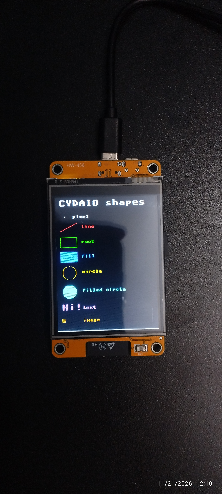

# CYDAIO 🟡

**Cheap Yellow Display, All In One.**

One file. One yellow screen. Zero excuses.

CYDAIO is a tiny, beginner-friendly MicroPython library for the **ESP32-2432S028R (2 USB) Cheap Yellow Display**. It’s for people who want their CYD to draw stuff, react to touch, and generally be useful — without adopting 12 driver files and a wiring diagram as dependents.

> **Tested on:** ESP32-2432S028R 2USB (ILI9341 + XPT2046) with MicroPython. ✅

## What is this thing?

You copy **one file** onto your board: `cydaio.py`.  
Then your Cheap Yellow Display goes from “cute yellow brick” to “tiny touchscreen that actually listens to you”.

No pin-hunting. No config ritual. No sacrifice to the SPI gods (we already did that part).

## Getting started (the chill version)

1. **Flash MicroPython** onto your ESP32 CYD.
2. **Copy `cydaio.py`** onto the board (Thonny, mpremote, rshell — pick your favorite tool).
3. **Open an example** from the `examples` folder and run it.

That’s it. You are now officially doing embedded graphics. Put it on your résumé if you want. I won’t stop you.

## Fun things you can make it do

- **Paint with your finger** like it’s a very tiny, very yellow art studio.
- **Draw shapes** — circles, rectangles, lines, pixels, text, the whole geometry-class reunion.
- **Calibrate touch** by poking four corners like you’re waking it up politely.
- **Change brightness, rotation, and colors** when the screen has an attitude.

For actual ready-to-run code, check the [`examples/`](examples/) folder:
- **`paint.py`** — finger painting, no cleanup required.
- **`shapes.py`** — shapes showing off with labels.
- **`screencalibrate.py`** — poke corners, get better touch.

## Good to know (before you yell at the screen)

- **Only `cydaio.py` goes on the ESP32.** Everything else here is docs, examples, and good vibes.
- **Colors look weird?** CYD panels can be dramatic about colors. CYDAIO flips colors by default so they look right; you can turn that off if your panel is feeling different.
- **Touch being spicy?** Run the calibration example. If it still acts haunted, there’s an IRQ-gating option in the docs.
- **Tiny edge line?** Some panels have a one-pixel personality. There’s a screen offset option for that.
- **Got the ST7789 2USB variant?** This library waves politely from afar. It’s made for the ILI9341 2USB CYD.

## Want the nerdy details?

I kept this page code-free on purpose. When you’re ready for the real stuff:

- **[CHEATSHEET.md](CHEATSHEET.md)** — quick “what was that function called again?”
- **[REFERENCE.md](REFERENCE.md)** — full API, pin map, behavior, limits, all the grown-up details.
- **[examples/](examples/)** — copy, run, poke, smile.

## License

BSD-2-Clause. See [LICENSE](LICENSE).

Made for people who just want their yellow display to do the thing. 💛
